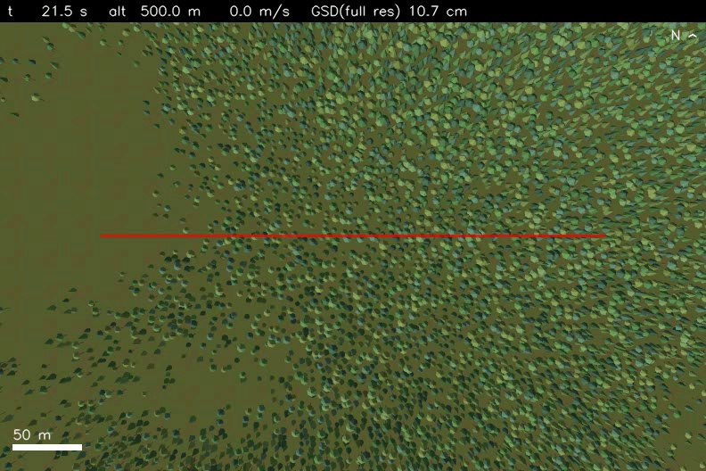
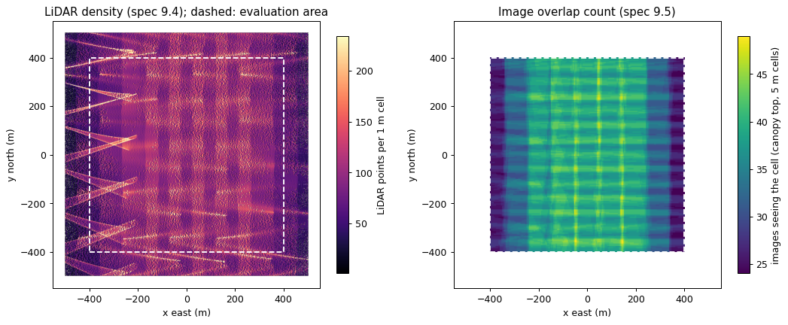
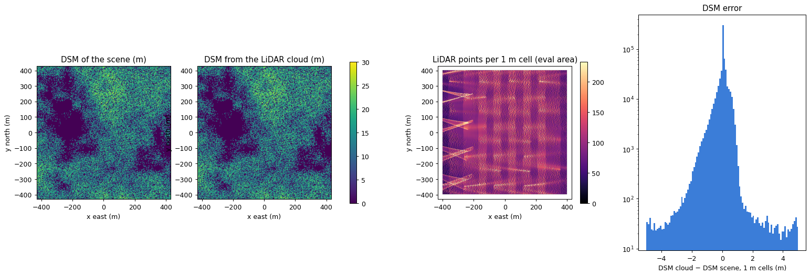

# Giai đoạn 2: kết quả các lượt chạy (17/11/2026)

Kế hoạch: [ke_hoach_chay.md](ke_hoach_chay.md). Giai đoạn 1: [ket_qua_kha_thi.md](ket_qua_kha_thi.md).
Mọi lượt chạy trên laptop của người dùng (RTX 3060, 15 GB RAM).

| # | Chức năng | Kết quả |
|---|---|---|
| R1 | Pose 500 Hz | ✓ |
| R2 | GUI, mô hình tĩnh + camera view | ✓ |
| R3 | GUI, bay đủ chu trình đến hạ cánh | ✓ |
| R4 | 25 m/s, 600 m, 2 tuyến | ✓ |
| R5 | Cấu hình chính 600 m / 10 tuyến | ✓ |
| R6 | Xuất LAS / COLMAP / kiểm tra 9.4–9.5 | ✓ |
| – | Hiệu năng: FPS, độ trễ, CPU/GPU (camera view) | ✓ |

## R1: pose 500 Hz

SceneBroadcaster `dynamic_pose_hertz` được đặt 500. Bài thử đồng bộ (rig bay 25 m/s, quỹ đạo đã biết):

| | Trước (giai đoạn 1) | R1 |
|---|---|---|
| Tần số pose | 59 Hz | **500 Hz** (khoảng cách tối đa 4 ms) |
| Độ trễ pose | 0 | 0 |
| Độ trễ LiDAR (sau khi trừ độ nghiêng tia) | 0 ± 1 ms | 0 ± 1 ms |
| Độ trễ camera | +1,7 ms | +1,7 ms |
| RTF | 0,76 | 0,79 |

## R2: GUI và camera view

- Mô hình tĩnh ở 500 m có GUI chạy được, RTF 0,88 (bằng lúc không GUI); không mất dòng LiDAR nào; 61 ảnh.
- RAM: Gazebo server 2,0 GB + GUI 1,8 GB.
- **Camera view:** có thêm camera xem trước, cùng vị trí và FOV với camera chính, 792 × 528 ở 10 Hz.
  - Trong GUI, nó là panel "Camera view".
  - Mỗi lượt chạy ghi video `camera_view.mp4`: vạch đỏ là dải quét LiDAR ±20°, kèm thước 50 m, thời gian, độ cao,
    tốc độ.

Bản sau, dùng trong R5, mở bằng `scripts/camera_window.sh`. Cửa sổ có ba phần:

1. **Điểm LiDAR thật** của 1 s gần nhất, chiếu lên ảnh và tô màu theo độ cao (đất tím → ngọn cây vàng). Có kèm hướng
   mũi máy bay.
2. **Mặt cắt ngang** của dòng quét mới nhất: tán cây và mặt đất như LiDAR thấy, kèm tỉ lệ tia chạm đất.
3. **Panel hiệu năng** (xem mục "Hiệu năng").

## R3: bay đủ chu trình, có GUI

Ở 500 m, 1 tuyến, mission chạy trọn:

1. VTOL cất cánh lên 60 m và chuyển sang bay bằng.
2. Leo vòng lên 500 m (3 phút), bay tuyến.
3. Hạ độ cao bằng vòng lượn xuống 100 m.
4. Chuyển về MC và hạ cánh tại home, lệch 8 cm; "Mission finished, landed", tự disarm.

Kết quả:

- Tuyến: lệch ngang tối đa 1,10 m, roll tối đa 0,28°.
- 21 ảnh cách 60,00 m (59,86–60,12); DSM 1 m: sai số tuyệt đối trung vị 0,18 m.
- RTF chỉ **0,50 khi có GUI lúc bay** (không GUI: 0,93). Lượt dài nên chạy không GUI.
- Sau tuyến, VTOL bay ngang lại qua rừng để về điểm hạ độ cao. Lượt quay về này bị loại khỏi dải đo, vì lệch hơn
  20 m so với mọi tuyến kế hoạch.

## R4: 25 m/s ở 600 m, 2 tuyến cách 95 m

FW_AIRSPD_TRIM = 25, FW_AIRSPD_MAX = 30 (mặc định PX4: 20); giới hạn ga 0,6 của airframe là đủ.

| | Dải 1 (N) | Dải 2 (S) | Tài liệu |
|---|---|---|---|
| Tốc độ đất | 25,80 m/s | 25,75 m/s | 25 m/s |
| Độ cao | 600,1–601,6 m | 600,1–601,2 m | 600 m |
| Lệch ngang trung bình / tối đa | +0,90 / 1,14 m | −0,60 / 3,04 m | – |
| Roll tối đa | 0,43° | 2,53° | 0 (lý tưởng) |

- Ảnh: chồng dọc **84,5 %** (tài liệu 84,52 %), chồng ngang **83,7 %** (tài liệu 83,66 %), GSD 12,9 cm ở nửa độ
  phân giải.
- Dải quét LiDAR 435,9 m (lý thuyết 436,8 m).
- Hạ cánh đúng home.

Hai điều rút ra cho R5:

- Ở 25 m/s, **mũi máy bay dao động ±5–13° quanh hướng bay** trong khi quỹ đạo vẫn thẳng. Vì vậy dải được nhận theo
  hướng chuyển động, không theo hướng mũi.
- **Vòng quay đầu 95 m** vọt ra ngoài 39 m và cần khoảng 400 m để ổn định. Đoạn vào tuyến được tăng từ 250 lên
  350 m.

## R5: cấu hình chính (600 m, 25 m/s, 10 tuyến cách 95 m)

Tuyến X = −427,5 + 95k, đo ở Y từ −650 đến 650, vào tuyến 350 m ở mỗi đầu. Camera chỉ chụp trên vùng rừng.

- Thời gian: 25 phút mô phỏng từ cất cánh đến hạ cánh, khoảng 27 phút thực.
- Có mở thêm GUI và cửa sổ camera view giữa chừng; RTF vẫn khoảng 1,0.
- Hạ cánh tại home, lệch 4 cm.

| | |
|---|---|
| Dải | **10/10**, mỗi dải 1300 m, 25,9–26,5 m/s, cao 598,6–601,9 m |
| Bám tuyến | lệch ngang tối đa **1,41 m**; roll tối đa 1,40° ở dải 2–10 và **4,19° ở dải 1** |
| LiDAR | 186 040 dòng, 200,0/s, **0 dòng mất**; trên các dải: 120 triệu tia, cách nhau 13 cm dọc tuyến |
| Chồng LiDAR giữa hai dải | 78 % (dải quét 437 m, khoảng tuyến 95 m chọn theo ảnh; tài liệu: 218 m cho 50 %) |
| Mật độ, vùng 800 × 800 m | **102 điểm/m²**; 99,84 % ô 1 m có điểm; 5 % ô dưới 36 điểm |
| Điểm đất | z = +0,0 ± 0,9 cm; **100 % ô 5 m** và 89 % ô 1 m có điểm chạm đất |
| Điểm so với bề mặt thật | 0,30 % cao hơn > 20 cm; mặt tán −0,1 ± 2,7 cm |
| DSM 1 m | 99,8 % ô có dữ liệu; độ lệch −0,00 m, sai số tuyệt đối trung vị 0,08 m, 95,2 % ô trong ±1 m |
| Ảnh | 220 ảnh trên các dải, cách nhau 60,00 m (59,71–60,28); chồng dọc **84,5 %**, chồng ngang **83,7 %** (tài liệu 84,52 / 83,66 %) |
| Số ảnh thấy mỗi ô 5 m (mặt tán) | tối thiểu 24, trung vị 37 |
| Trigger → ảnh | 1,7 ms trung bình, 4 ms tối đa |

**Dải 1 có dao động lăn tắt dần**, từ 4,2° xuống 0,9° dọc tuyến, trong khi lệch ngang vẫn ≤ 0,86 m. Nó vào tuyến
ngay sau vòng leo với góc đổi hướng lớn. Pose 500 Hz ghi đủ roll nên georeference vẫn đúng; dấu vết của nó là các
vệt mật độ chéo ở phía tây. Nếu muốn dải 1 sạch hơn, có thể dời tâm vòng leo xuống phía nam điểm vào tuyến 1, hoặc
kéo dài đoạn vào tuyến của riêng dải 1.

## R6: xuất dữ liệu (tài liệu mục 8)

`scripts/export_dataset.py out/r5_main --lines 10 --spacing 95` ghi 2,7 GB vào `out/r5_main/export/`:

- `trajectory.csv`: 500 Hz, kèm `strip_id` và cờ survey/transit.
- `lidar/strip_*.npz`: phép đo gốc.
- `las/strip_01..10.las`: **93,6 triệu điểm**, LAS 1.2 PDRF 1, gps_time = thời gian mô phỏng,
  point_source_id = dải, góc quét −20..20°; cắt theo vùng đánh giá + 100 m. Cả 10 file được `laspy` 2.7 đọc đúng.
- `truth/labels_strip_*.npz`: nhãn đất/tán và mã cây, để riêng khỏi LAS.
- `colmap/sparse/0`: PINHOLE 4752 × 3168, pose world-to-camera cho 220 ảnh, cùng `reference_positions.txt`.
  Chiếu đỉnh cây bằng pose COLMAP khớp phép chiếu dùng cho ảnh chồng tới 10⁻⁸ px.
- `checks.json`, `coverage.png`: các kiểm tra 9.4 và 9.5 ở trên.

## Hiệu năng: các node có chạy ổn với tài nguyên máy không

Panel bên phải cửa sổ camera view hiện FPS, độ trễ, tốc độ dòng LiDAR, khung của camera chính, CPU/RAM của từng
tiến trình và GPU. Mỗi dòng có màu xanh/vàng/đỏ theo ngưỡng; tất cả được ghi vào `run/perf_<thời gian>.csv` mỗi
giây.

Ngưỡng:

- Tốc độ dòng, số tia, khoảng chụp: theo tài liệu.
- CPU, GPU, độ trễ: tài liệu không quy định, nên dùng mức an toàn tự đặt: CPU < 70 %, RAM trống > 2 GB,
  GPU < 85 %, độ trễ < 50 ms.

Số liệu dưới đây lấy từ 8 phút cuối của R5 (tuyến 6–10, hạ độ cao, hạ cánh), 482 mẫu. Lúc đó chạy đồng thời
Gazebo server, GUI, PX4, `lidar_node`, `camera_node`, node ghi video và cửa sổ camera view.

| | Trung vị | p95 | Tối đa | Đạt |
|---|---:|---:|---:|:-:|
| RTF | 1,0 | 1,0 | – | ✓ |
| LiDAR dòng/s mô phỏng (tài liệu 200) | 200,0 | 200,0 | 200,0 (min 200,0) | ✓ |
| LiDAR dòng mất | 0 | 0 | 0 | ✓ |
| Camera view fps (mô phỏng / thực) | 10,0 / 9,8 | – | – | ✓ |
| Độ trễ LiDAR | 2 ms | 4 ms | 325 ms (đỉnh lẻ) | ✓ |
| Độ trễ ảnh xem trước + vẽ | 3 + 29 ms | 8 + 35 ms | 520 ms (đỉnh lẻ) | ✓ |
| CPU toàn máy (16 luồng) | 39 % | 53 % | 72 % | ✓ |
| RAM trống | 4,9 GB | – | min 4,3 GB | ✓ |
| GPU | 33 % | 53 % | 66 % | ✓ |
| VRAM / nhiệt độ GPU | 1,9–2,2 / 6,1 GB | – | 65 °C | ✓ |

CPU theo tiến trình (100 % = một lõi), trung vị / tối đa:

| Tiến trình | CPU | RAM |
|---|---|---|
| Gazebo server | 161 / 185 % | 2,0 GB |
| Gazebo GUI | 134 / 151 % | 1,9 GB |
| PX4 | 22 / 28 % | |
| `lidar_node` | 15 / 29 % | |
| `camera_node` | 11 / 112 % | |
| Video + cửa sổ camera view | 89 / 108 % | |

`camera_node` tăng vọt mỗi lần ghi một PNG 15 MP (1,05 s/ảnh). Khoảng chụp là 2,4 s ở 25 m/s, nên còn dư.

**Kết luận:** trên laptop này, các node theo kịp đúng nhịp của tài liệu với dư địa lớn:

- LiDAR không mất dòng nào; camera không bỏ ảnh nào.
- Máy dùng chưa tới nửa CPU và GPU.

Những gì dễ thành nút thắt:

- GUI Gazebo (1,3 lõi, 1,9 GB).
- Ghi PNG ở độ phân giải đầy đủ 61 MP, chưa thử. Ước tính ~4 s mỗi ảnh, vượt khoảng 2,4 s, nên cần ghi song song
  hoặc dùng JPEG.
