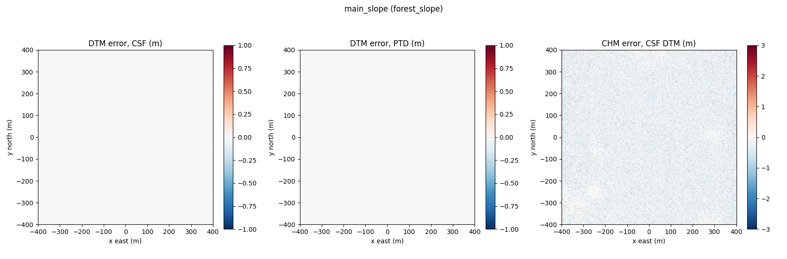

# Giai đoạn 3: làm môi trường mô phỏng khớp tài liệu (19/11/2026)

Giai đoạn 1: [ket_qua_kha_thi.md](ket_qua_kha_thi.md). Giai đoạn 2: [ket_qua_giai_doan_2.md](ket_qua_giai_doan_2.md).

Yêu cầu của lần này: rà lại mô phỏng so với [tài liệu](../Thong_so_mo_phong_VTOL_mapping_rung.md), làm khớp hết phần
rừng và LiDAR, dựng máy bay đúng cỡ CW‑30E; thêm số liệu LiDAR trong camera window, node dựng point cloud 3D và
hiển thị trên RViz.

## 1. Đối chiếu trước và sau

| Mục tài liệu | Giai đoạn 2 | Giai đoạn 3 |
|---|---|---|
| §6 Kích thước cảnh | Rừng 1,4 × 1,4 km | **2 × 2 km** (129 554 cây), vùng đánh giá 800 × 800 m |
| §6 Địa hình | Chỉ đất phẳng | **Phẳng (`forest`) và dốc nhẹ (`forest_slope`)**: dốc 2,5° về phía đông + đồi ±8 m; trong vùng đánh giá cao −18,5…+19,3 m; vùng cất cánh phẳng |
| §6 Texture cho SfM | Tán 8 màu trơn | Mỗi màu tán một texture cụm lá 0,3–0,7 m (4 m/lần lặp, lệch ngẫu nhiên theo cây); đất 2048 px/100 m |
| §6 Dữ liệu chuẩn | DTM = 0, DSM, CHM | DTM từ chính mesh địa hình (chính xác), DSM, CHM, lưới địa hình; độ cao gốc từng cây |
| §2 Chế độ LiDAR | Ghi 300 kHz / 1200 m (mâu thuẫn với khoảng xung 600 kHz) | **600 kHz / 5–880 m** |
| §2 Thời điểm từng tia | Cả dòng tại một thời điểm (Gazebo) | **`lidar_exact.py`**: tia k phát ở t_s + k/600 000 s (cửa sổ 2,22 ms), pose nội suy tại đúng thời điểm đó, dò tia trên mesh cảnh |
| §4 Máy bay | `standard_vtol` 5 kg, sải 2,1 m | **`cw30e_mapping`**: 38 kg (gồm tải), sải 4,4 m, dài 2,4 m, 25 m/s |
| §3 Ảnh | PNG 4752 × 3168 | Như cũ; thêm `IMG=jpg` (JPEG 95, tài liệu §8 cho phép) để tiết kiệm đĩa |

## 2. Rừng

Hai cảnh dùng chung seed 2026, cùng vị trí cây; cảnh dốc chỉ khác ở địa hình (cây đặt lên mặt đất, gốc thân chôn
1 m để không hở trên dốc). Ảnh xem trước: `models/<cảnh>/truth_chm.png`.

**Texture và SfM.** Đo bằng `scripts/texture_pairs.sh`: rig tĩnh ở 600 m chụp 6 ảnh (2 tuyến cách 95 m × 3 điểm
cách 60 m, đúng hình học bay), ghép SIFT, rồi dùng pose thật để đếm cặp điểm khớp đúng (khoảng cách Sampson < 1,5 px).

| | Rừng cũ (màu trơn) | Rừng mới (texture) |
|---|---|---|
| Dọc tuyến (60 m): cặp khớp đúng / tỉ lệ đúng | 2 596 / 96 % | 2 578 / **99 %** |
| Ngang tuyến (95 m): cặp khớp đúng / tỉ lệ đúng | 1 654 / 95 % | 1 357 / **98 %** |
| Ô 3 × 3 của ảnh có điểm khớp | 9/9 | 9/9 |

Cả hai đủ cho SfM; texture làm tỉ lệ khớp sai giảm (từ 4–5 % xuống 1–2 %).

Hai lỗi đã gặp và sửa trong bộ sinh rừng:

- Chỉ số tọa độ texture (`vt`) trong OBJ dùng chung bộ đếm với đỉnh; thân cây (không texture) đứng trước làm chỉ
  số vượt quá. Gazebo cảnh báo "texcoord indices out of bounds", texture tán bị gán sai, có lần crash.
- Gazebo (ogre2) đọc texture theo sRGB: phải mã hóa gamma, nếu không tán gần như đen.

## 3. LiDAR

**Kiểm tra trên đất phẳng (§9.1),** 600 m, so với cự ly hình học H / cos β:

| | Gazebo (góc danh nghĩa) | Gazebo (đã hiệu chuẩn) | `lidar_exact.py` |
|---|---|---|---|
| Sai số cự ly lớn nhất | ±12 cm | < 1 mm | **0,1 mm** (độ chính xác float32) |

**Trên rừng** (chuyến R4 của giai đoạn 2, 2 dải, cùng các dòng quét; so điểm với bề mặt thật của cảnh):

| | Gazebo | `lidar_exact.py` |
|---|---|---|
| Sai số trên mặt tán | −0,1 ± 3,0 cm | **−0,0 ± 0,3 cm** |
| Điểm cao hơn bề mặt thật > 5 cm | 1,6 % | **0,007 %** |
| Ô 1 m có điểm (vùng đánh giá) | 89,4 % | **95,6 %** |
| DSM 1 m: trong ±1 m | 86,9 % | **96,3 %** |

Gazebo lệch góc tia tới 0,057° ngang tuyến và 0,98 mrad dọc tuyến, tức tới 0,6 m ở 600 m; trên mặt nón của tán,
điều đó đổi điểm chạm vài mét (p05/p95 của chênh cự ly từng tia: ±2,4 m). Bản dò tia dùng đúng góc danh nghĩa và
đúng lịch phát tia, nên là nguồn LiDAR chính cho báo cáo và xuất dữ liệu (`lidar_exact/`); bản Gazebo vẫn dùng để
xem trực tiếp.

Tốc độ: khoảng 2 triệu tia/s trên 16 luồng; 10 tuyến ở 600 m (~250 triệu tia) mất khoảng 2 phút.

## 4. Máy bay cỡ CW‑30E

JOUAV không công bố khí động, quán tính hay dữ liệu động cơ của CW‑30E (tài liệu §4 cũng ghi vậy). Hai model VTOL
khác có trong PX4 (tiltrotor, quadtailsitter) khác cấu hình; CW‑30E là quadplane 4 + 1 giống `standard_vtol`. Vì
vậy `cw30e_mapping` là `standard_vtol` dựng lại theo cỡ CW‑30E (`scripts/make_models.py`, `CW30E`):

| | standard_vtol | cw30e_mapping |
|---|---|---|
| Khối lượng | 5 kg | **38 kg** (MTOW, gồm ~5,3 kg cảm biến) |
| Sải cánh / dài | 2,14 m / – | **4,4 m / 2,4 m** |
| Quán tính Ixx / Iyy / Izz | 0,48 / 0,34 / 0,81 | 13 / 11 / 22 kg·m² (từ phân bố khối lượng) |
| Cánh | 1,0 m² | 2,2 m² (dây cung 0,5 m) |
| Đuôi ngang / đứng | 0,01 m² / – | 0,4 m² / 0,15 m² |
| Rotor nâng | 4 × 45 N, cách tâm 0,35 m | 4 × 233 N (T/W 2,5), cách tâm 0,72 m |
| Động cơ đẩy | 105 N | 250 N |
| Tốc độ bay bằng | 17 m/s | **25 m/s** |

Tham số PX4 (`config/cw30e_px4_params.json`): vị trí rotor cho control allocation, lực nâng hover, hệ số vòng tốc
độ góc MC, tốc độ 25 m/s, roll ≤ 35°, tốc độ góc ≤ 30°/s, vòng lượn 150 m, TECS chậm hơn.

Ba lần bay thử (200 m, có vòng quay đầu 95 m):

| Lần | Thay đổi | Kết quả |
|---|---|---|
| 1 | Cánh lái tính theo gia tốc góc | Roll vọt lố (81°/s khi lệnh 37°/s), thất tốc, rơi |
| 2 | Cánh lái giảm một nửa, giới hạn roll | Bay được nhưng dao động dọc ±8 m/s; PX4 kết luận cảm biến tốc độ khí hỏng, bay không có tốc độ khí, thất tốc khi hạ vòng, quad-chute ở 8 m rồi đáp |
| 3 | Đuôi ngang 0,4 m² (hệ số thể tích đuôi ~0,37 như máy bay thật), đuôi đứng, TECS | **Trọn chu trình**: tuyến 24,7–25,0 m/s, độ cao ±0,5 m, roll 0,4°; chuyển về MC ở 115 m, đáp thẳng đứng 1,5 m/s |

## 5. Bay cấu hình chính (600 m, 25 m/s, 10 tuyến cách 95 m)

`scripts/main_run.sh`, máy bay `cw30e_mapping`, ảnh JPEG 95. Rừng phẳng: `out/main_flat/` (có xuất LAS + COLMAP).
Rừng dốc: `out/main_slope/` (`EXPORT=0`: đĩa còn ~3 GB). Mỗi lượt khoảng 27 phút mô phỏng, chạy gần thời gian thực
(không GUI).

| | Rừng phẳng | Rừng dốc | Tài liệu |
|---|---|---|---|
| Dải | 10/10, mỗi dải 1300 m | 10/10 | 10 |
| Tốc độ đất | 25,34 m/s | 25,31 m/s | 25 m/s |
| Độ cao | 599,5–604,9 m | 598,5–603,5 m (AGL lúc chụp 581–621 m) | 600 m AGL |
| Lệch ngang / roll tối đa | 1,50 m / 1,54° | 1,58 m / 1,42° | roll = 0 (lý tưởng) |
| Bề rộng dải quét | 436,6 m | 452,7 m (địa hình thấp hơn ở phía tây) | 436,76 m ở 600 m |
| Mật độ, vùng 800 × 800 m | 104,4 điểm/m² | 104,6 điểm/m² | – |
| Ô 1 m có điểm | 100 % | 100 % | – |
| Điểm đất so với DTM thật | +0,0 ± 0,9 cm | +0,0 ± 0,9 cm | – |
| Sai số trên mặt tán | −0,0 ± 0,3 cm | −0,0 ± 0,3 cm | – |
| Ô 1 m / 5 m có tia chạm đất | 93,2 % / 100 % | 93,2 % / 100 % | – |
| DSM 1 m trong ±1 m | 96,6 % | 96,6 % | – |
| Ảnh trên dải, khoảng chụp | 220, 60,00 m (59,72–60,25) | 220, 60,00 m | 60 m |
| Chồng dọc / ngang | 84,6 % / 83,7 % | 84,5 % / 83,7 % | 84,52 / 83,66 % |
| SfM: cặp khớp đúng dọc / ngang (tỉ lệ đúng) | 2 548 (99 %) / 1 030 (96 %) | 2 634 (99 %) / 1 003 (96 %) | – |
| Map 3D (voxel 1 m, `lidar_map.py`) | 130 M điểm, 17,7 M voxel | 131 M điểm, 14,0 M voxel | – |

Số liệu LiDAR ở bảng trên là bản `lidar_exact`. Bản Gazebo của cùng chuyến (rừng phẳng): sai số mặt tán ±2,8 cm,
1,4 % điểm cao hơn bề mặt > 5 cm, 99,76 % ô 1 m có điểm, 85,7 % ô chạm đất.

DSM có độ lệch +0,53 m so với DSM chuẩn: DSM chuẩn lấy cực đại trên 16 mẫu mỗi ô 1 m, nên hụt đỉnh nhọn của tán
nón (lệch tới ~0,2 m ngang trên sườn dốc 5:1); LiDAR mật độ 104 điểm/m² chạm gần đỉnh hơn. Đây là giới hạn của
raster chuẩn, không phải sai số đo (điểm so với bề mặt chính xác: ±0,3 cm).

Xuất dữ liệu rừng phẳng (`out/main_flat/export/`): LAS 1.2 theo dải với gps_time là thời điểm riêng của từng tia,
nhãn đất/cây theo DTM thật, COLMAP (pose khớp phép chiếu tới 10⁻⁷ px).

Bộ nhớ: báo cáo một lượt 10 dải cần ~8,4 GB RAM (đã đổi sang tính theo khối, float32/int32; bản cũ cần > 10 GB và
bị hệ thống dừng khi có VS Code và trình duyệt mở).

## 6. Công cụ mới

| Công cụ | Việc |
|---|---|
| `scripts/lidar_exact.py` | LiDAR đúng lịch phát tia (§2) |
| `scripts/lidar_map.py`, `scripts/lidar_rviz.sh`, `rviz/lidar.rviz` | Map 3D (voxel, mặt đất, chiều cao tán) từ LiDAR, trực tiếp hoặc phát lại, hiển thị RViz |
| `scripts/camera_view.py` (panel LiDAR) | Số liệu LiDAR trực tiếp, thang màu, bản đồ nhìn từ trên |
| `scripts/sfm_check.py`, `scripts/texture_pairs.sh` | Kiểm tra điểm liên kết SfM |
| `scripts/main_run.sh` | Cấu hình chính một lệnh: bay, dò tia, báo cáo, SfM, map, xuất |
| `scripts/scene.py` | Dữ liệu chuẩn theo cảnh (DTM chính xác trên địa hình dốc) |
| `scripts/ground_eval.py` | §9.6: CSF + PTD, DTM/DSM/CHM, một bảng cho nhiều cảnh |
| `scripts/view_cloud.py` | Xem map 3D (Open3D, nền sáng, bảng số liệu, bật/tắt lớp) |
| `scripts/compact_runs.py` | Nén lại các lượt trong `out/` không mất dữ liệu |

## 7. Tách đất, DTM / DSM / CHM (§9.6)

`python3 scripts/ground_eval.py out/main_flat out/main_slope` chạy cả hai cảnh và ghi một bảng chung
(`out/ground_eval.md`). Dữ liệu: các điểm LiDAR (`lidar_exact`) của 10 tuyến trong vùng 800 × 800 m (+20 m biên).
Hai bộ lọc chạy trên mẫu con ngẫu nhiên 10 điểm/m² (7,06 triệu điểm), như §9 yêu cầu ghi lại mức giảm mẫu:

- **CSF**: gói `cloth-simulation-filter`, độ phân giải vải 1 m, `class_threshold` 0,5 m, rigidness 3 (phẳng) / 2 (dốc).
- **PTD**: viết trong script theo Axelsson. Hạt giống là điểm thấp nhất mỗi ô 25 m và mỗi 5 m dọc biên. Mỗi vòng
  thêm các điểm cách mặt TIN ≤ 0,5 m và có góc tới các đỉnh tam giác ≤ 10°.

Nhãn chuẩn: một điểm là đất khi nằm trong 5 cm quanh địa hình chính xác của cảnh. DTM 1 m nội suy tuyến tính từ
điểm đất của mỗi bộ lọc. DSM là điểm cao nhất mỗi ô. CHM = DSM − DTM. DSM chuẩn là bề mặt cao nhất thật trong ô:
lấy 4 × 4 mẫu và thêm điểm gần đỉnh nón tán nhất.

| | Phẳng (`main_flat`) | Dốc (`main_slope`) |
|---|---:|---:|
| Tỉ lệ điểm đất (chuẩn) | 42,1 % | 42,1 % |
| CSF precision / recall / F1 | 0,999 / 1,000 / 0,999 | 0,999 / 1,000 / 0,999 |
| PTD precision / recall / F1 | 0,999 / 0,999 / 0,999 | 0,999 / 0,997 / 0,998 |
| DTM (CSF) bias / RMSE | +0,001 / 0,010 m | +0,001 / 0,011 m |
| DTM (PTD) bias / RMSE | +0,001 / 0,010 m | +0,001 / 0,010 m |
| Ô 1 m có điểm đất | 83,9 % | 83,8 % |
| DSM bias / RMSE, trong 0,5 m | −0,28 / 1,51 m, 91,9 % | −0,28 / 1,51 m, 91,9 % |
| CHM (CSF) bias / RMSE | −0,28 / 1,51 m | −0,28 / 1,51 m |
| Ô có dữ liệu DSM | 100 % | 100 % |

Cách đọc kết quả:

- **Bộ lọc gần như hoàn hảo** ở cả hai cảnh. Lý do là cảnh lý tưởng:
  - mặt đất là mesh sạch, không có cây bụi thấp, không có nhiễu cự ly;
  - tán cây bắt đầu ở vài mét trên mặt đất.

  Vì vậy con số này kiểm tra quy trình và hình học, không phải độ khó của dữ liệu thật. Muốn đánh giá bộ lọc thật
  sự cần thêm cây bụi, nhiễu và nhiều phản hồi.
- **16 % số ô không có điểm đất** (dưới tán dày). DTM ở các ô đó là nội suy, nhưng vẫn đúng tới cm vì địa hình
  trơn. Độ dốc 2,5° và các đồi ±8 m không làm kết quả kém đi.
- **Sai số DSM/CHM nằm ở mép tán, không phải ở DTM.**
  - Tán là hình nón cao tới 16 m trên bán kính khoảng 2,5 m, nên trong một ô 1 m độ cao đổi vài mét.
  - Điểm LiDAR hiếm khi trúng đúng đỉnh nón, nên DSM thấp hơn chuẩn trung bình 0,28 m.
  - 92 % số ô sai trong vòng 0,5 m. RMSE 1,5 m đến từ phần đuôi ở mép tán.
  - CHM có cùng sai số với DSM, vì DTM chỉ sai khoảng 1 cm.
- Cảnh dốc đã xuất bộ dữ liệu đầy đủ (`out/main_slope/export/`, LAZ, 725 MB).

## 8. Còn lại

- §9.6 đã xong (mục 7). Một bộ lọc đất có ý nghĩa trên dữ liệu khó hơn cần thêm cây bụi, nhiễu và nhiều phản hồi.
- Nhiều phản hồi, footprint 0,21 m, cường độ phản xạ: tài liệu xếp ngoài phạm vi lý tưởng. `lidar_exact.py` đã
  dò tia trên mesh nên có thể mở rộng sang tia con trong footprint khi cần.
- Động lực học thật của CW‑30E cần số liệu từ đội UAV (tài liệu §4, bảng "Khi cần UAV tự bay").
- Ảnh 9504 × 6336: chưa chạy thử (`make_models.py --image full`).
