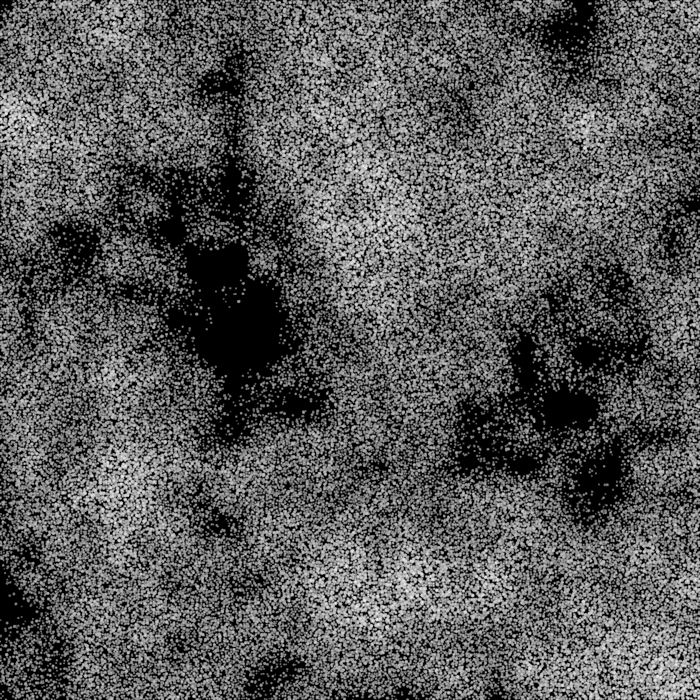
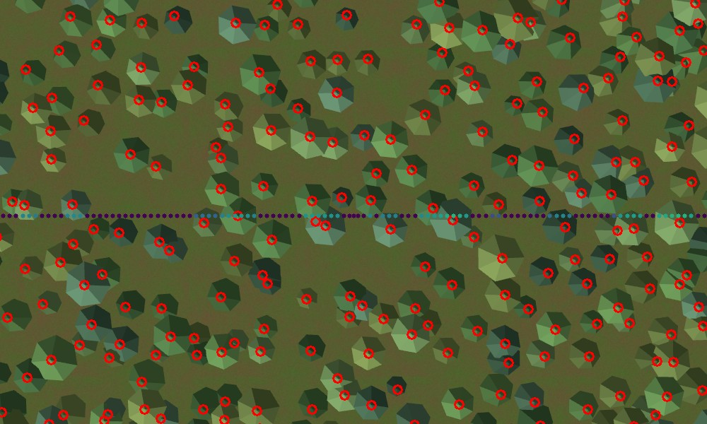
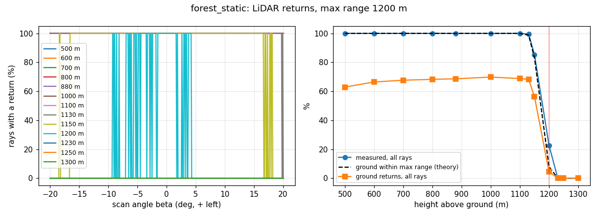
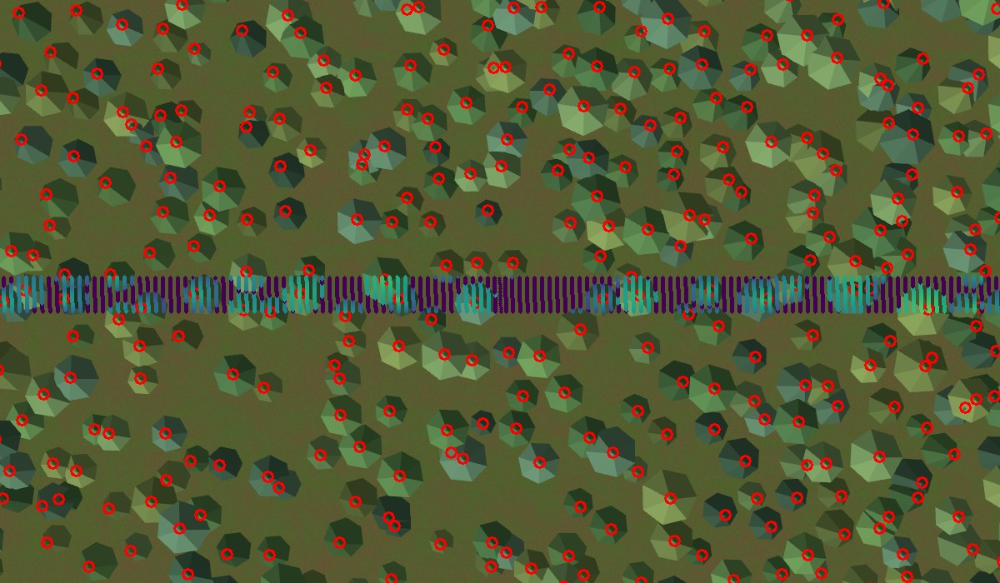
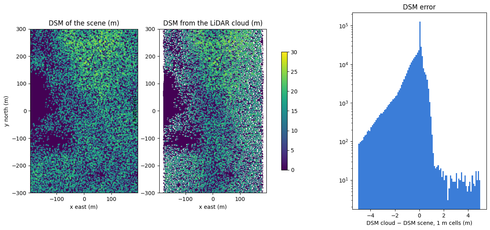

# VTOL + LiDAR + camera trên rừng: kết quả kiểm tra khả thi

Ngày chạy: 12–17/11/2026. Yêu cầu và thông số thiết bị: [Thong_so_mo_phong_VTOL_mapping_rung.md](../Thong_so_mo_phong_VTOL_mapping_rung.md).
Cách chạy lại: [README](../README.md).

## Kết luận

**Khả thi.** Trên Gazebo Harmonic + PX4 SITL, một VTOL mang camera nadir (Sony ILX‑LR1 + 35 mm) và LiDAR quét
dòng (thông số RIEGL VUX‑240²⁴) đã thu được dữ liệu dùng được cho mapping rừng ở 500 m AGL. Kết quả gồm:

- **Hai node chạy cùng lúc** với PX4: 200 dòng/s × 1333 tia (266 600 tia/s), không mất dòng nào. Camera chụp theo
  khoảng cách 60 m. Mô phỏng chạy ở 0,87–0,93 lần thời gian thực trên laptop RTX 3060.
- **Ngưỡng LiDAR khớp lý thuyết** ở cả hai chế độ:
  - 1200 m (300 kHz): đủ dải đến H ≈ 1128 m, chỉ còn nadir ở 1200 m, mất hẳn từ 1230 m.
  - 880 m (600 kHz): đủ dải đến 827 m, mất hẳn từ 900 m.
- **Hình học đúng.**
  - Trên đất phẳng, sai số cự ly < 1 mm sau hiệu chuẩn.
  - Đỉnh cây chiếu vào ảnh trùng tán cây.
  - Trong chuyến bay, điểm trên mặt tán lệch −0,1 ± 2,7 cm so với bề mặt thật, và điểm đất ở z = 0,1 ± 1,0 cm.
- **Đồng bộ thời gian.** Đo trên vật chuyển động đã biết quỹ đạo:
  - LiDAR: 0 ± 1 ms.
  - Camera: +1,7 ms, tức khoảng 0,4 px, nằm trong độ phân giải của phép đo.

Để đạt các con số trên phải sửa hoặc hiệu chuẩn bốn điểm của simulator (mục 6). Thiếu chúng thì sai số đám điểm
lên tới 0,5 m. Các giới hạn còn lại ở mục 7.

## 1. Cấu hình đã dựng

| Thành phần | Trong mô phỏng | So với tài liệu |
|---|---|---|
| Cảnh | Rừng thủ tục 1,4 × 1,4 km, 63 320 cây cao 10–30 m (60 % lá kim hình nón, 40 % lá rộng hình nón kép), có khe tán và khoảng trống; độ che phủ 66 % (CHM > 2 m); 1,5 triệu tam giác trong 49 tile; đất phẳng có texture | Mục 6: đất phẳng trước, cây 10–30 m, có khe hở; DTM/DSM/CHM chuẩn 1 m sinh trực tiếp từ hình học cây |
| VTOL | PX4 `standard_vtol` (airframe 4004), payload gắn vào `base_link` | CW‑30E chưa có mô hình động lực học (mục 4); payload không khối lượng |
| Camera | Pinhole 4752 × 3168 (cùng FOV 54,04° × 37,56°), fx = fy = 4658,824, không méo; nadir, cạnh dài ngang tuyến; kích chụp mỗi 60 m | Mục 3: bước kiểm tra "nửa độ phân giải" |
| LiDAR | `gpu_lidar` ±20°, 1333 tia/dòng, 200 dòng/s, tầm 5–1200 m (hoặc 880 m), không nhiễu | Mục 2, đúng bảng "giá trị đưa vào mô phỏng" |
| Gá | Giữa bụng; camera ở z = −0,18 m, LiDAR ngay dưới camera ở z = −0,42 m; R_BC như mục 5 | Mục 5 (thay t = 0 bằng vị trí gá thật) |
| Đồng hồ | Một đồng hồ mô phỏng, bước 1 ms (200 dòng/s rơi đúng bước) | Mục 5 |

## 2. Mô hình tĩnh ở 500 m: camera nhìn xuống

VTOL kích thước CW‑30E (2,4 × 4,4 m) được giữ cố định ở 500 m trên rừng, mũi hướng bắc. Hai node chạy cùng lúc.

- Ảnh có kích thước đúng, K do Gazebo phát ra trùng K tính từ thông số hãng.
- GSD 10,7 cm/px ở mặt đất. Ảnh đầy đủ 9504 px sẽ cho 5,37 cm như tài liệu.
- Footprint 510 × 340 m.
- Đỉnh của 63 320 cây trong `trees.csv` được chiếu vào ảnh (vòng đỏ) và trùng tâm tán. Ảnh có hướng bắc lên, đông
  sang phải, đúng R_BC.
- Dòng LiDAR được chiếu vào ảnh và tô màu theo độ cao. Nó nằm đúng hàng cy, chuyển xanh lơ khi qua tán và tím khi
  chạm đất.

## 3. Ngưỡng LiDAR 500–1300 m

Rig được dời theo độ cao bằng `set_pose`. Mỗi mức ghi 4 s mô phỏng (800 dòng). Theo hình học, dải ±20° còn đủ khi
H/cos 20° ≤ tầm tối đa.

**Chế độ 1200 m (300 kHz):**

| H (m) | Tia có phản hồi | Nadir | Mép ±20° | Phản hồi từ đất | Cự ly (m) |
|---:|---:|---:|---:|---:|---|
| 500 | 100 % | 100 % | 100 % | 62,9 % | 480,6–531,7 |
| 600 | 100 % | 100 % | 100 % | 66,5 % | 580,5–638,1 |
| 880 | 100 % | 100 % | 100 % | 68,6 % | 859,8–936,1 |
| 1000 | 100 % | 100 % | 100 % | 69,8 % | 979,6–1063,8 |
| 1100 | 100 % | 100 % | 100 % | 68,8 % | 1080,3–1169,5 |
| 1130 | 99,6 % | 100 % | 93 % | 68,5 % | 1109,9–1199,9 |
| 1150 | 85,4 % | 100 % | 0 % | 66,0 % | 1129,2–1199,7 |
| 1200 | 22,6 % | 100 % | 0 % | 19,3 % | 1178,2–1200,0 |
| 1230–1300 | 0 % | 0 % | 0 % | – | – |

**Chế độ 880 m (600 kHz):** đủ dải đến 800 m. Ở 830 m mép còn 61 %, ở 860 m mép mất hẳn, ở 880 m chỉ còn nadir,
và ở 900–950 m không còn phản hồi.

Ở mọi độ cao: 200,0 dòng/s, 0 dòng bị mất, camera vẫn chụp đều.

Ở 500 m (cấu hình đề tài) cự ly lớn nhất là 532 m. Chế độ 600 kHz (880 m) vẫn còn 348 m biên, nên có thể chọn
600 kHz để có mật độ cao hơn như tài liệu đề xuất.

**Lưu ý:** trong mô phỏng ngưỡng là một mức cắt cứng. Tầm 1200 m / 880 m của hãng chỉ đúng với phản xạ ≥ 20 %,
và trong rừng năng lượng xung còn bị chia cho nhiều bề mặt (mục 7).

## 4. Chuyến bay PX4 ở 500 m

Mission chạy qua MAVLink:

1. VTOL cất cánh lên 60 m.
2. Chuyển sang bay bằng.
3. Bay vòng tròn leo lên 500 m.
4. Bay một tuyến dọc trục bắc–nam qua tâm rừng.

LiDAR chỉ ghi khi độ cao > 450 m. Camera được kích bằng topic trigger mỗi 60 m.

| | |
|---|---|
| Tuyến | 1300 m trong 74,2 s, 17,5 m/s, cao 499,9–501,1 m |
| Bám tuyến | lệch ngang ≤ 0,97 m, roll ≤ 0,23° |
| LiDAR | 14 841 dòng (200,0/s), cách nhau 8,8 cm; 19,8 triệu tia, 100 % có phản hồi |
| Dải quét / mật độ | 363 m (lý thuyết 364 m), 41,9 điểm/m² |
| Điểm đất | 41,2 % số điểm; z = +0,1 ± 1,0 cm (chuẩn: 0) |
| Điểm so với bề mặt thật của cảnh | 0,27 % cao hơn > 20 cm; điểm trên mặt tán −0,1 ± 2,7 cm |
| DSM 1 m (lấy max mỗi ô) | 88,6 % số ô có dữ liệu; sai số tuyệt đối trung vị 0,20 m; 84,5 % ô trong ±1 m |
| Chạm đất | 58 % ô 1 m, **98,8 % ô 5 m** có ít nhất một điểm đất (đủ để nội suy DTM dưới tán) |
| Ảnh | 22 ảnh trên tuyến, cách nhau 60,00 m (59,82–60,13); chồng dọc 81,3 % ở mặt tán 30 m (tài liệu: 81,23 %) |
| Trễ từ trigger đến ảnh | 5,2 ms trung bình, tối đa 10 ms |
| Tài nguyên | RTF 0,93; Gazebo ~2,1 GB RAM; PNG 17,6 MB/ảnh, ghi mất 1,1 s; ~1 MB/s LiDAR thô |

DSM 1 m bị lệch âm (−0,63 m trung bình) vì tán hình nón có đỉnh nhọn: trong một ô 1 m, đám điểm hiếm khi trúng đúng
điểm cao nhất. Đây là đặc tính của lấy mẫu, không phải lỗi định vị. So từng điểm với bề mặt thật thì chỉ còn sai số
cỡ cm.

## 5. Đồng bộ thời gian (mục 9.3)

Ở bài thử riêng, rig bay thẳng 25 m/s ở 500 m, nên vị trí thật là một hàm đã biết của thời gian. Rig bay qua hai
mục tiêu: một bậc 20 m có mép vuông góc với tuyến, và một bậc 10 m có mép xiên 5,7°. Với mép xiên, mỗi tia chạm bậc
ở một thời điểm riêng cách nhau 1,1 ms, nên độ phân giải đạt cỡ 1 ms.

| Luồng | Độ trễ so với timestamp |
|---|---|
| Pose (`dynamic_pose/info`, 59 Hz) | 0,00 ms |
| LiDAR (sau khi trừ độ nghiêng tia, mục 6) | 0 ± 1 ms; giống nhau ở 50, 100 và 200 dòng/s |
| Camera (hàng pixel của mép trong 10 ảnh) | +1,7 ms (1,0–2,4); 1 px = 4,1 ms |

## 6. Bốn vấn đề của simulator đã sửa hoặc hiệu chuẩn

1. **Mặt đất `<plane>` hữu hạn với DART.** Spawn cách gốc 1,9 km, VTOL rơi xuyên đất rồi lượn đi; ở ≤ 1 km thì bình
   thường. Cách sửa: đổi sang hộp 6 × 6 km.
2. **Link payload gần như không khối lượng gắn bằng khớp fixed** làm mô phỏng vật lý nổ tung. Cách sửa: gắn sensor
   và visual thẳng vào `base_link`.
3. **Góc ngang tuyến của `gpu_lidar` lệch khỏi giá trị danh nghĩa** tới 0,057° (Gazebo lấy mẫu depth texture). Hậu
   quả: sai số cự ly tất định, std 5,6 cm ở 500 m, tối đa 35 cm ở 1100 m. Hiệu chuẩn một lần trên đất phẳng
   (`config/lidar_angles.json`) còn < 1 mm ở mọi độ cao.
4. **Tia `gpu_lidar` nghiêng ra sau 0,98 mrad** (khoảng 0,48 m dọc tuyến ở 500 m), giống nhau ở mọi tần số dòng và
   tỉ lệ đúng theo cự ly. Hậu quả: 29 % điểm bay cao hơn bề mặt thật > 20 cm, và trông giống như trễ 19 ms. Hiệu
   chuẩn bằng bài thử mép xiên đưa con số này về 0,27 %.

   Bẫy khi đo: mặt đứng của bậc xiên hơi quay về hướng tây nam, nên các tia bên trái chạm nó sớm. Phải chỉ tính các
   lần chạm mặt trên của bậc.

## 7. Giới hạn còn lại

- **Mô hình cảm biến lý tưởng:** tia mảnh, một phản hồi, ngưỡng tầm cứng, không phụ thuộc phản xạ, không footprint
  0,35 mrad, không nhiễu. Hiệu ứng nhìn xuyên tán, nhiều phản hồi và tầm thực theo vật liệu chưa đánh giá được.
- **Dòng LiDAR render tức thời.** Mọi tia trong một dòng có chung thời điểm, chưa áp lịch 1/600 000 s mỗi xung.
- Ở **H ≥ 880 m** còn nhiễu lượng tử hóa texel: 1–6 % điểm tán lệch > 5 cm, có dấu đối xứng nên không phải sai lệch
  hệ thống.
- **VTOL là `standard_vtol` của PX4**, không phải CW‑30E:
  - bay 17,5 m/s thay vì 25 m/s (FW_AIRSPD_TRIM 17, trùng kịch bản so sánh 17 m/s của tài liệu);
  - payload không khối lượng.
- **Pose 59 Hz.** Nội suy đủ tốt khi bay thẳng (±2,7 cm). Khi quay vòng hoặc có nhiễu động, cần ≥ 200 Hz như tài
  liệu, ví dụ lấy pose từ ulog của PX4 hoặc plugin pose publisher.
- **Ảnh ở nửa độ phân giải.** Ảnh 61 MP đầy đủ nặng gấp 4 lần (~70 MB PNG, ~4 s ghi). Ở 25 m/s, khoảng chụp 2,4 s,
  nên cần ghi song song hoặc JPEG.
- **Chưa làm:** 600 m với 10 tuyến cách 95 m, tách đất CSF/PTD, DTM/CHM và precision/recall (mục 9.6); cảnh dốc;
  gió.

## 8. Bước tiếp theo đề xuất

1. Cấu hình chính của tài liệu: 600 m, 10 tuyến cách 95 m, vùng đánh giá 800 × 800 m. Thời gian mô phỏng khoảng 15
   phút; dữ liệu khoảng 2,5 GB LiDAR và 300 ảnh.
2. Lấy pose 200 Hz từ ulog (hoặc tăng tần số pose của Gazebo), xuất LAS/LAZ và COLMAP/SfM theo mục 8.
3. Chạy CSF/PTD → DTM/DSM/CHM và báo precision/recall/F1 lớp đất, bias/RMSE (mục 9.6).
4. Mô hình phản xạ + footprint (tia con) để đánh giá tầm thực và nhiều phản hồi trong rừng.
